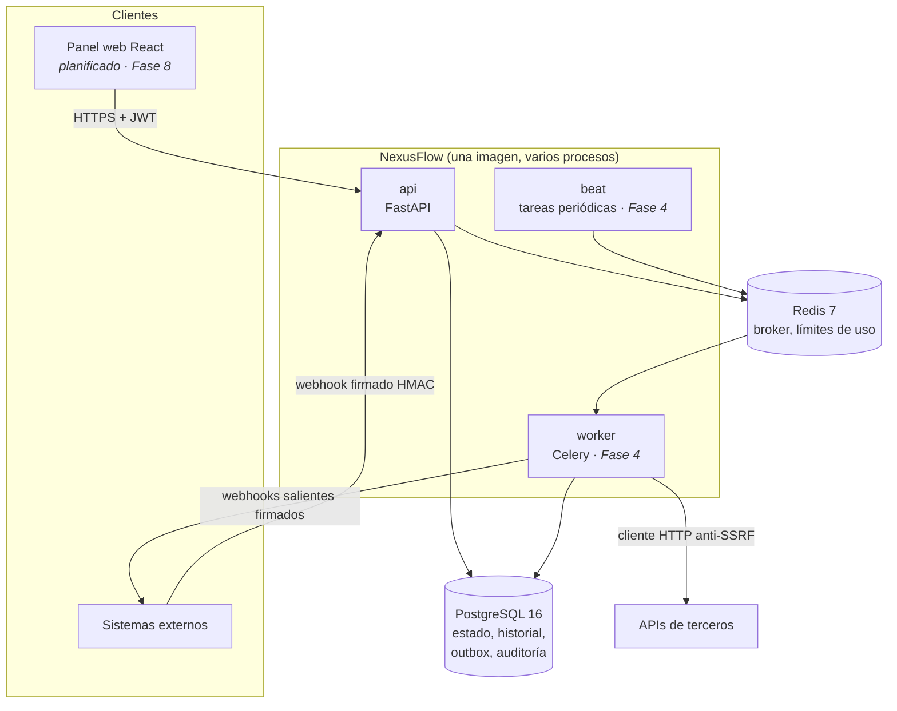
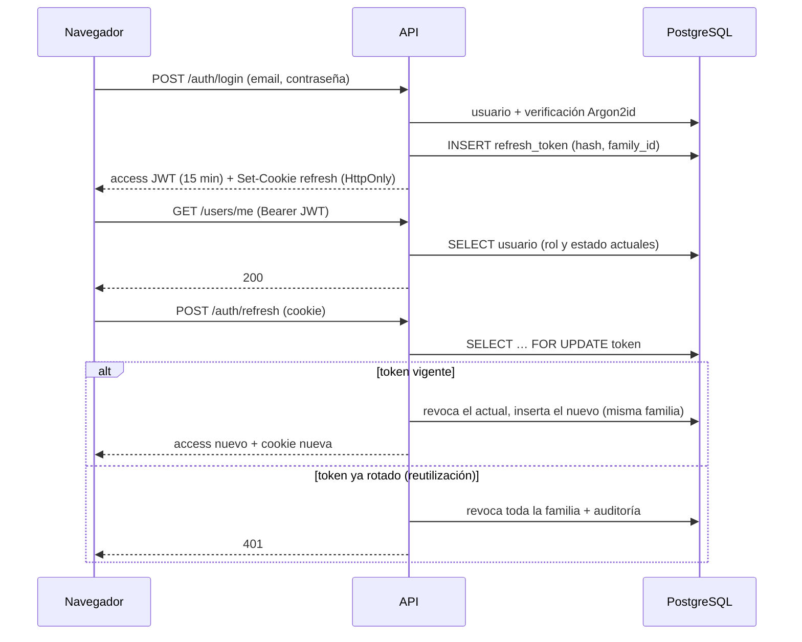

# Arquitectura de NexusFlow

> Documento vivo. Las secciones marcadas como *planificado* describen el diseño aprobado
> que todavía no está implementado.

## 1. Contexto

NexusFlow permite a equipos de operaciones definir flujos de trabajo (pasos, condiciones
y acciones) que se integran con APIs REST externas y se ejecutan en segundo plano, con
historial completo, reintentos seguros y webhooks.

## 2. Vista de contenedores



| Proceso | Responsabilidad | Escala por |
|---|---|---|
| `api` | HTTP, validación, autorización, encolado | Peticiones por segundo |
| `worker` | Ejecución de pasos y llamadas externas | Trabajos pendientes / latencia externa |
| `beat` | Recuperar ejecuciones colgadas, reenviar el outbox | No escala (una instancia) |
| `migrate` | `alembic upgrade head` antes de arrancar la API | Una ejecución por despliegue |

## 3. Módulos del backend

Cada módulo de dominio sigue las mismas capas. La dependencia va siempre hacia dentro:

```
api (routers, esquemas HTTP)  →  services (casos de uso)  →  repositories (SQL)
                                         ↓
                                  domain (reglas puras, sin I/O)
```

| Módulo | Estado | Contenido |
|---|---|---|
| `core` | ✅ | Configuración, logging, errores, middleware, límites de uso |
| `db` | ✅ | Base declarativa con convención de nombres, sesiones async |
| `observability` | ✅ parcial | Health checks (métricas en la Fase 7) |
| `auth` | ✅ | Usuarios, contraseñas, tokens, permisos, endpoints |
| `workflows` | Fase 3 | DSL, validación, versiones |
| `engine` | Fase 4 | Máquina de estados, orquestador, condiciones |
| `integrations` | Fase 5 | Adaptadores, credenciales cifradas, cliente HTTP seguro |
| `webhooks` | Fase 6 | Entrantes (HMAC) y salientes (outbox) |
| `audit` | ✅ escritura | Registro de acciones sensibles (la consulta llega en la Fase 7) |

## 4. Ciclo de una petición (implementado)

1. `RequestContextMiddleware` (ASGI puro, el más externo):
   - asigna o valida `X-Request-ID`;
   - lo vincula a los logs mediante `contextvars`;
   - añade las cabeceras de seguridad;
   - registra `http_request` con el método, la ruta, el status y `duration_ms`.
2. CORS, solo si hay orígenes configurados.
3. Router → dependencias → handler.
4. En rutas protegidas: `HTTPBearer` → validación del JWT → carga del usuario desde
   PostgreSQL (rol y estado actuales) → comprobación del permiso exigido.
5. Cualquier excepción se transforma en `application/problem+json` (RFC 9457). Los 500 se
   registran con traza en el log y devuelven al cliente un mensaje genérico.

## 4.1 Sesión de usuario (implementado)



## 5. Health checks

| Endpoint | Para qué | Consulta dependencias |
|---|---|---|
| `/health/live` | *Liveness*: reiniciar el contenedor si el proceso se cuelga | No: un fallo de la base de datos no debe provocar reinicios en cascada |
| `/health/ready` | *Readiness*: sacar la instancia del balanceador si no puede atender | Sí: PostgreSQL (`SELECT 1`) y Redis (`PING`) en paralelo y con timeout |

La respuesta de `/ready` indica qué componente falló, pero no por qué. El motivo va al log
(`readiness_check_failed`) para no exponer topología interna.

## 6. Modelo de datos (planificado)

Las tablas se crean fase a fase mediante migraciones. Diseño aprobado:

| Tabla | Fase | Restricciones clave |
|---|---|---|
| `users`, `refresh_tokens`, `audit_log` | 2 ✅ | Ver [data-model.md](data-model.md) |
| `workflows`, `workflow_versions` | 3 | `UNIQUE(workflow_id, version)`; inmutable tras publicar |
| `triggers` | 3/6 | Secreto HMAC cifrado |
| `workflow_runs` | 4 | `UNIQUE(workflow_id, idempotency_key)` |
| `step_runs`, `step_attempts` | 4 | `UNIQUE(run_id, step_id)` |
| `credentials` | 5 | Secreto cifrado (Fernet / MultiFernet); nunca se serializa |
| `inbound_webhook_events` | 6 | `UNIQUE(trigger_id, event_key)`: deduplicación y anti-replay |
| `webhook_subscriptions`, `webhook_deliveries` | 6 | Outbox con índice parcial sobre las pendientes |

## 7. Garantías de ejecución (planificado, Fase 4-5)

- **Entrega *at-least-once* de Celery** (`acks_late`). Cada tarea toma su paso con
  `SELECT … FOR UPDATE` y verifica que la transición de estado sea válida, así que un
  mensaje duplicado no produce un efecto doble.
- **Clave de idempotencia por paso** (`run_id:step_id`), estable entre reintentos y
  enviada como `Idempotency-Key`.
- **Clasificación de fallos externos:**
  - *No enviada* (conexión, DNS, 429/503 con `Retry-After`): se reintenta con backoff
    exponencial y *jitter*.
  - *Resultado desconocido* (timeout tras enviar): solo se reintenta si la acción es
    idempotente. Si no lo es, el paso pasa a `needs_review`.

## 8. Despliegue

Ver la sección Docker del [README](../README.md). La guía de despliegue en una VM (proxy
inverso con TLS, copias de seguridad, rotación de secretos) se completa en la Fase 9.
