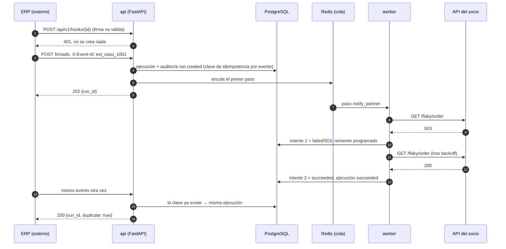

# Caso de estudio: un pedido que llega por webhook y sobrevive a un 503

Un ERP avisa a NexusFlow de un pedido nuevo (`PED-1001`). El flujo debe avisar a una API
externa de un socio, que en ese momento responde **503**. Después, el ERP reenvía el mismo
evento porque no está seguro de que llegara. Lo que tiene que pasar:

1. Una petición sin la firma correcta no crea nada.
2. La firmada crea **una** ejecución y responde `202` enseguida (el trabajo va al worker).
3. El 503 no hace fallar la ejecución: se reintenta con backoff.
4. El segundo intento tiene éxito.
5. El reenvío del ERP devuelve la misma ejecución (`200`, `duplicate: true`) y **no** vuelve
   a llamar al socio.
6. Queda rastro: un único `run.created` en la auditoría y los dos intentos en el historial.

Todo esto lo comprueba una sola prueba de integración, contra PostgreSQL y Redis reales y
un servidor HTTP real que hace de socio:
[`backend/tests/integration/test_case_study_webhook_flow.py`](../backend/tests/integration/test_case_study_webhook_flow.py).

## Secuencia



## Límites de confianza

| Frontera | Qué entra | Control | Dónde |
|---|---|---|---|
| Internet → `api` | Cuerpo del webhook | Firma HMAC con marca de tiempo (anti-replay), 404 indistinguible para disparadores desconocidos, límite de uso por disparador | `webhooks/signing.py`, `webhooks/service.py::receive` |
| `api` → PostgreSQL | Estado | Es la **fuente de verdad**: la ejecución, la clave de idempotencia y la auditoría se guardan en la misma transacción | `engine/service.py::create_run` |
| `api` → Redis → `worker` | Mensajes | Redis solo transporta; un mensaje duplicado o perdido no cambia el resultado (reclamo atómico en PostgreSQL y barrido de recuperación) | `engine/runner.py` |
| `worker` → socio | Petición saliente | Cliente HTTP anti-SSRF (sin IPs privadas ni metadatos cloud salvo lista explícita); credenciales cifradas en PostgreSQL que el worker descifra al ejecutar el paso | `engine/http_client.py`, `integrations/` |

## Decisiones que hacen que funcione

- **Idempotencia por evento, no por petición.** La clave es `wh:<disparador>:<X-Event-Id>`
  (o el hash del timestamp y el cuerpo firmados si el emisor no manda id). Por eso el
  reenvío del ERP no crea otra ejecución.
- **Clasificación de fallos.** `408`, `429` y `503` se tratan como «rechazado sin procesar»:
  siempre reintentables. Otros 5xx son «resultado incierto»: se reintentan solo si el paso
  es idempotente (p. ej. GET, o PUT con `Idempotency-Key`); si no, la ejecución queda en revisión manual en vez de arriesgar un cobro
  doble (`engine/http_client.py::classify_status`).
- **El webhook responde antes de llamar al socio.** La API solo guarda y encola; la
  latencia o la caída del socio no afectan al ERP.

## Comprobación de que la prueba detecta fallos

La prueba se validó con dos mutaciones temporales del código (revertidas después):

| Mutación | Resultado |
|---|---|
| La clave de idempotencia del webhook pasa a `None` (cada entrega es nueva) | Falla: el reenvío devuelve `202` en lugar de `200` |
| El 503 se clasifica como error permanente | Falla: la ejecución termina en `failed` en vez de reintentar |

## Cómo ejecutarla

Con PostgreSQL y Redis de prueba (ver «Pruebas y calidad» en el [README](../README.md)):

```powershell
cd backend
uv run pytest tests/integration/test_case_study_webhook_flow.py -v
```

## Qué no cubre

- La cola es el `RecordingDispatcher` del arnés, no Celery; el camino con un worker Celery
  real está en `test_celery_worker.py`.
- El backoff del reintento es de 0,1 s para que la prueba sea rápida.
- Las notificaciones salientes (outbox y entrega firmada) se prueban aparte en
  `test_webhooks.py`.
