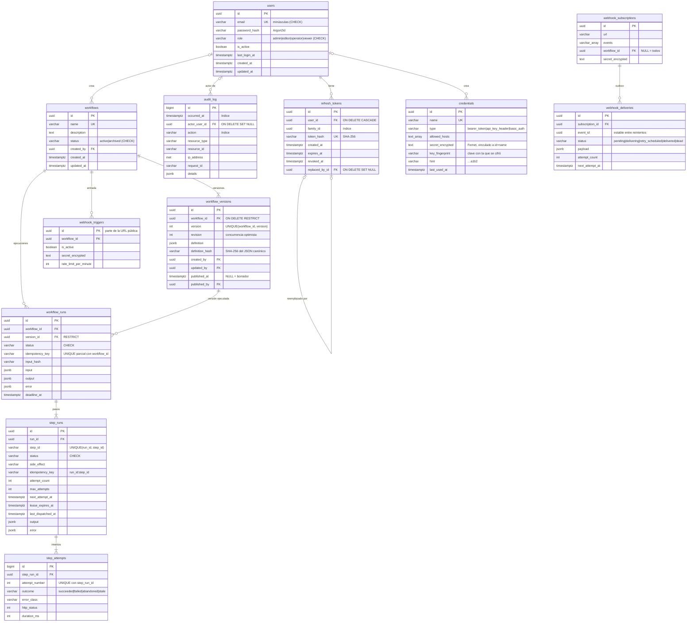

# Modelo de datos

> Refleja las migraciones aplicadas hasta la **Fase 6**. Cada fase añade sus tablas
> mediante una migración de Alembic; `alembic check` en CI garantiza que modelos y
> migraciones coinciden.

## Decisiones

| Decisión | Motivo |
|---|---|
| Claves UUID generadas en la aplicación | El id se conoce antes del INSERT y no revela el volumen de registros. `audit_log` usa `bigint`: es solo de inserción, se ordena por id y nunca se expone para enumerar. |
| `role` como `VARCHAR` + `CHECK` en lugar de `ENUM` nativo | Añadir un rol es una migración trivial; con `ENUM` habría que usar `ALTER TYPE`, que tiene restricciones dentro de transacciones. |
| `email` en minúsculas garantizado por `CHECK` | La aplicación normaliza, pero la base de datos es la última línea de defensa contra duplicados como `Ana@` y `ana@`. |
| Unicidad por restricción, no por consulta previa | Comprobar y luego insertar tiene una condición de carrera. Hay una prueba con 5 registros simultáneos. |
| Solo el hash del refresh token | Una copia de la base de datos no permite secuestrar sesiones. |
| `family_id` en refresh tokens | Permite revocar de una vez todos los tokens derivados de un mismo login. |
| `audit_log` con `ON DELETE SET NULL` | El historial sobrevive a la eliminación de usuarios. |
| `timestamptz` en todas las fechas | Nunca fechas sin zona horaria. |
| Índice único parcial `(workflow_id) WHERE published_at IS NULL` | Como máximo un borrador por flujo, garantizado por la base de datos. |
| Trigger `trg_workflow_versions_immutable` | Rechaza `UPDATE`/`DELETE` de una versión publicada: lo ejecutado no puede cambiar. |
| `definition_hash` | Identifica la definición exacta (JSON canónico) en auditoría y ejecuciones. |
| `workflows` sin borrado físico | Se archivan; `RESTRICT` en la FK impide borrar un flujo con versiones. |
| `UNIQUE (workflow_id, idempotency_key) WHERE idempotency_key IS NOT NULL` | Creación idempotente de ejecuciones, también con peticiones simultáneas. |
| `version_id` con `RESTRICT` | Cada ejecución apunta a la versión exacta (inmutable) que ejecutó. |
| Índice parcial `ix_step_runs_dispatch` | El barrido solo recorre pasos activos, no el historial completo. |
| `step_attempts` separado de `step_runs` | Historial completo de cada intento sin sobrescribir el anterior. |
| `credentials.secret_encrypted` sin columna en claro | El secreto solo existe cifrado; `key_fingerprint` permite saber qué filas faltan por rotar. |
| `webhook_deliveries` como outbox | Se inserta en la misma transacción que el cambio de estado (hook `before_flush`). |
| Deduplicación de entrada sin tabla propia | Reutiliza el índice único de idempotencia de `workflow_runs`. |
| Convención de nombres de restricciones | Nombres deterministas (`uq_users_email`, `fk_refresh_tokens_user_id_users`), así las migraciones son reproducibles. |

## Tablas planificadas

Ver [architecture.md §6](architecture.md#6-modelo-de-datos-planificado).
