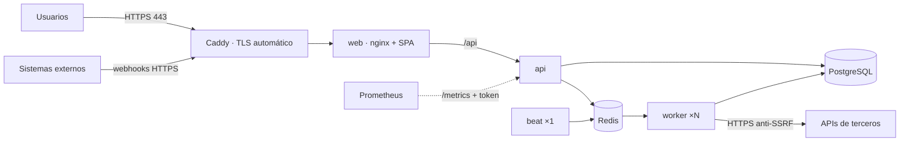

# Guía de despliegue

Despliegue de referencia: **una máquina virtual Linux con Docker Compose**, con Caddy como
proxy TLS. Es suficiente para un equipo o una pyme. La sección [Escalar](#escalar) explica
qué cambiar cuando deje de serlo.



## 1. Requisitos

- VM con 2 vCPU y 4 GB de RAM como mínimo (Ubuntu 24.04 LTS o similar).
- Docker Engine con el plugin Compose v2.24 o superior (el override usa `!reset`).
- Un dominio con registro DNS `A`/`AAAA` apuntando a la VM.
- Puertos 80 y 443 abiertos. **Ningún otro**: PostgreSQL, Redis y la API no se publican.

## 2. Configuración

```bash
git clone https://github.com/JuanSGarciaC/nexusflow.git && cd nexusflow
cp .env.example .env
chmod 600 .env          # solo el usuario que despliega puede leerlo
```

Genera **todos** los secretos; en producción la API no arranca con valores de ejemplo:

```bash
python3 -c "import secrets; print(secrets.token_hex(32))"     # POSTGRES_PASSWORD, REDIS_PASSWORD, NEXUSFLOW_SECRET_KEY
python3 -c "import base64, os; print(base64.urlsafe_b64encode(os.urandom(32)).decode())"   # NEXUSFLOW_CREDENTIALS_ENCRYPTION_KEYS
```

Añade a `.env`:

```dotenv
NEXUSFLOW_DOMAIN=nexusflow.tu-empresa.com
# Opcional: token para que Prometheus lea /metrics
NEXUSFLOW_METRICS_TOKEN=<token_hex(24)>
```

Para un entorno serio, guarda estos valores en un gestor de secretos (Vault, AWS Secrets
Manager, 1Password…) y genera `.env` al desplegar en lugar de dejarlo en el disco.

## 3. Arranque

```bash
docker compose -f docker-compose.yml -f deploy/docker-compose.prod.yml up -d --build
docker compose -f docker-compose.yml -f deploy/docker-compose.prod.yml exec api \
  nexusflow create-admin --email admin@tu-empresa.com
```

Comprueba (lo rápido a mano):

```bash
curl -fsS https://nexusflow.tu-empresa.com/health/ready
curl -sI  https://nexusflow.tu-empresa.com/ | grep -iE "strict-transport|content-security"
```

### Comprobación completa desde fuera

```bash
SMOKE_EMAIL=admin@tu-empresa.com SMOKE_PASSWORD='...' CHECK_PORTS=1 \
  scripts/smoke-prod.sh https://nexusflow.tu-empresa.com
```

[`scripts/smoke-prod.sh`](../scripts/smoke-prod.sh) mira el despliegue como lo vería un
cliente o un atacante: HTTP redirige a HTTPS y el **certificado es válido** (sin `-k`),
HSTS ≥ 1 año, CSP restrictiva, `Server` sin versión, `/docs`, `/openapi.json` y `/metrics`
cerrados, API sin token → 401, registro público desactivado, PostgreSQL (5432), Redis
(6379) y la API (8000) **no publicados**, y con credenciales: cookie de sesión
`HttpOnly; Secure; SameSite=Strict; Path=/api/v1/auth` y misma respuesta 401 para un
usuario inexistente y una contraseña errónea (sin enumeración de usuarios).

**Qué está probado y qué no.** El CI levanta este mismo stack de producción (override `prod`,
Caddy con HTTPS) con el dominio `localhost` —Caddy emite un certificado de su CA interna— y
ejecuta ese script, además de comprobar que la **IP del cliente** llega a la auditoría (no la
de Caddy ni la de nginx) y que un `X-Forwarded-For` falsificado desde fuera se ignora. Eso
prueba la configuración, las cabeceras y la cadena de proxies. **No prueba, porque necesita
un servidor y un dominio reales:** que el DNS apunte bien, que Let's Encrypt emita y renueve
(puertos 80/443 abiertos, límites de emisión), el firewall del proveedor ni que la IP real
del cliente se conserve en tu red (en Docker Desktop el cliente aparece como la puerta de
enlace de Docker, `172.28.0.1`; en un VPS Linux debería verse la IP pública, pero
compruébalo en `audit_log` tras tu primer acceso).

Qué hace el override de producción ([`deploy/docker-compose.prod.yml`](../deploy/docker-compose.prod.yml)):

| Cambio | Motivo |
|---|---|
| Solo Caddy publica puertos (80/443) | Superficie mínima; TLS y HSTS automáticos |
| `NEXUSFLOW_ENV=production` | La API rechaza secretos de ejemplo, CORS `*`, cookies sin `Secure` y salida HTTP a hosts privados |
| `/docs` y registro público desactivados | Los usuarios los crea un administrador |
| `TRUSTED_PROXY_CIDR` = IP fija de Caddy | nginx toma la IP real del cliente solo de Caddy; la API, solo de nginx. Límites de uso y auditoría ven la IP correcta y nadie puede falsificarla |

## 4. Actualizaciones

```bash
git pull
docker compose -f docker-compose.yml -f deploy/docker-compose.prod.yml up -d --build
```

- El servicio `migrate` aplica `alembic upgrade head` **antes** de que arranquen la API y el
  worker. Si una migración falla, la versión nueva no arranca y la anterior sigue en marcha.
- El worker tiene `stop_grace_period: 60s`: termina las tareas en curso antes de parar.
  Si una tarea se corta, `acks_late` la devuelve a la cola y el reclamo en PostgreSQL
  impide ejecutarla dos veces (ADR-0007).
- Migraciones con cambios incompatibles: hacerlas en dos pasos (expandir y luego contraer)
  para que la versión anterior siga funcionando mientras se despliega.

## 5. Copias de seguridad

PostgreSQL es la única fuente de verdad. Redis solo guarda la cola y los contadores de
límites; perderlo no pierde datos, porque el barrido periódico reencola lo pendiente.

### Hacer la copia

```bash
# Con el override de producción; sin él, omite COMPOSE_FILES
export COMPOSE_FILES="-f docker-compose.yml -f deploy/docker-compose.prod.yml"
scripts/backup.sh          # → ./backups/nexusflow-AAAAMMDDTHHMMSSZ.dump
```

[`scripts/backup.sh`](../scripts/backup.sh) hace `pg_dump -Fc` (comprimido, permite
restaurar tablas sueltas), lo escribe en un archivo temporal y solo lo renombra si
`pg_restore --list` puede leerlo (nunca queda una copia a medias con aspecto de válida),
aplica permisos `600` y borra las de más de 14 días (`BACKUP_RETENTION_DAYS`). Si defines
`BACKUP_AGE_RECIPIENT` (clave pública de [age](https://age-encryption.org)), la cifra.

Programarla a diario con cron (copia a las 03:15, ajusta la ruta):

```cron
15 3 * * * cd /opt/nexusflow && COMPOSE_FILES="-f docker-compose.yml -f deploy/docker-compose.prod.yml" scripts/backup.sh >> /var/log/nexusflow-backup.log 2>&1
```

**Cifrada y fuera de la VM.** Una copia en el mismo disco no protege del fallo del disco, y
una copia en claro fuera de él es una fuga de datos. El flujo recomendado:

```bash
age-keygen -o age.key            # UNA vez. Guarda age.key en un gestor de secretos, NO en la VM
export BACKUP_AGE_RECIPIENT=age1...     # la clave PÚBLICA que imprime age-keygen
scripts/backup.sh                # → backups/nexusflow-....dump.age (cifrada)
rclone config                    # una vez: S3, Backblaze B2, SFTP...
scripts/backup-offsite.sh remoto:nexusflow-backups
```

[`scripts/backup-offsite.sh`](../scripts/backup-offsite.sh) **se niega a subir volcados sin
cifrar**, usa `rclone copy` (un borrado en el origen nunca borra el remoto), verifica con
`rclone check` que lo subido es idéntico y aplica una retención remota aparte (30 días).
La VM solo necesita la clave **pública**: si la roban, el atacante puede *crear* copias pero
no *leer* las existentes. Para restaurar se necesita la privada:
`AGE_IDENTITY=age.key scripts/restore-check.sh copia.dump.age`.

**Si pierdes `age.key`, las copias cifradas son irrecuperables.** Guárdala en al menos dos
sitios independientes de la VM y de las claves Fernet.

### Probar la restauración

```bash
scripts/restore-check.sh backups/nexusflow-AAAAMMDDTHHMMSSZ.dump
```

[`scripts/restore-check.sh`](../scripts/restore-check.sh) restaura en una base
**temporal** (no toca la real ni para servicios, así que es seguro en producción) y
comprueba: que `pg_restore` termina sin errores, que existen las mismas tablas, que la
versión de migración coincide y que ninguna tabla tiene más filas que el origen (con
`STRICT_COUNTS=1`, exactamente las mismas; úsalo solo sin tráfico). Después borra la base
temporal. **El CI ejecuta copia + restauración en cada cambio** sobre el stack con datos de
demostración, así que si alguien rompe el esquema o el formato de la copia, el CI falla.

Probado con una copia truncada, una copia con más filas que el origen y un archivo vacío:
en los tres casos el script termina con error.

### Restaurar de verdad (desastre)

```bash
docker compose $COMPOSE_FILES stop api worker beat
docker compose $COMPOSE_FILES exec -T postgres pg_restore -U nexusflow -d nexusflow --clean --if-exists < backups/nexusflow-AAAA.dump
docker compose $COMPOSE_FILES start api worker beat
```

Si perdiste la VM entera: despliega de nuevo (secciones 2 y 3), restaura la copia con el
comando anterior y recupera las claves `NEXUSFLOW_CREDENTIALS_ENCRYPTION_KEYS` de su
almacén. Sin ellas la base se restaura pero las credenciales no se pueden descifrar.

### Lo que esto NO garantiza

- **RPO = intervalo entre copias**: con una copia diaria se pueden perder hasta 24 h de
  datos. No hay archivado de WAL ni recuperación a un instante (PITR); si hace falta,
  usa una base gestionada o `pgBackRest`/`wal-g`.
- **RTO no medido**: la prueba del CI usa datos de demostración (unos 50 KB); el tiempo con
  datos reales depende del tamaño y no se ha medido.
- **El CI prueba el mecanismo, no tu proveedor**: ejecuta copia cifrada con `age`, subida con
  `rclone` a un destino **local** y restauración desde esa copia. No prueba S3/B2/SFTP reales
  (credenciales, permisos, tamaños grandes, cortes de red).
- Las claves Fernet **no** van en la copia (adrede): guárdalas aparte
  ([key-rotation.md](key-rotation.md)); si van juntas, quien robe la copia tiene también
  los secretos.

## 6. Rotación de secretos

Política, calendario y respuesta ante filtraciones: [key-rotation.md](key-rotation.md).

| Secreto | Procedimiento | Efecto |
|---|---|---|
| `NEXUSFLOW_CREDENTIALS_ENCRYPTION_KEYS` | Pon la clave nueva **delante** (`nueva,antigua`), reinicia, ejecuta `nexusflow rotate-credentials` y después quita la antigua | Sin interrupción (MultiFernet) |
| `NEXUSFLOW_SECRET_KEY` | Cambiar y reiniciar | Los access tokens en vuelo dejan de valer; las sesiones se recuperan con el refresh token (vive en la BD) |
| Secreto de un webhook entrante | `POST /api/v1/triggers/{id}/rotate-secret` | El anterior deja de valer al instante; avisa antes al emisor |
| `POSTGRES_PASSWORD` / `REDIS_PASSWORD` | Cambiar en el servicio y en `.env`, reiniciar | Interrupción breve |

## 7. Observabilidad

- **Logs**: JSON en stdout, con `request_id` en cada línea. Con `docker compose logs` basta
  para empezar; en producción, envíalos a Loki, CloudWatch o Elastic.
- **Métricas**: Prometheus lee la API **dentro de la red** (nginx devuelve 404 en `/metrics`):

  ```yaml
  scrape_configs:
    - job_name: nexusflow
      metrics_path: /metrics
      authorization: { type: Bearer, credentials_file: /etc/prometheus/nexusflow_token }
      static_configs: [{ targets: ["api:8000"] }]
  ```

  Hay un Prometheus + Grafana de referencia con un dashboard de 13 paneles y 9 alertas
  probadas (API caída, 5xx, latencia, cola sin vaciar, ejecuciones fallidas, revisión manual,
  dead-letter de webhooks): [`deploy/observability/`](../deploy/observability/README.md), con
  Alertmanager enviando a Slack (probado de extremo a extremo con un receptor falso; confirma
  la entrega con tu webhook real).
- **Programaciones cron**: las dispara `beat` (a través de la tarea de barrido, cada 15 s).
  **Si `beat` está parado, no se ejecuta ninguna programación**; vigílalo igual que al worker.
  Tras una caída, los disparos con más de 5 minutos de retraso
  (`NEXUSFLOW_SCHEDULE_MISFIRE_GRACE_SECONDS`) se omiten y quedan anotados en el último error
  de cada programación.
- **Health checks**: `/health/live` para reinicios, `/health/ready` para balanceadores.

## 8. Lista de comprobación de seguridad

- [ ] Todos los secretos generados; `.env` con permisos `600` y fuera del repositorio.
- [ ] Solo los puertos 80/443 abiertos en el cortafuegos.
- [ ] `NEXUSFLOW_ENV=production` (lo pone el override).
- [ ] Registro público desactivado; usuarios creados por un administrador.
- [ ] Copias de PostgreSQL cifradas y fuera de la VM (la restauración la prueba el CI con `scripts/restore-check.sh`; ejecútala también contra tu copia real).
- [ ] Claves de cifrado de credenciales guardadas aparte de las copias.
- [ ] `NEXUSFLOW_METRICS_TOKEN` definido si se usa Prometheus.
- [ ] Actualizaciones de seguridad de la VM y reconstrucción periódica de las imágenes.
- [ ] Hosts de cada credencial limitados a los necesarios (`allowed_hosts`).

## Escalar

| Síntoma | Medida |
|---|---|
| Cola de pasos creciendo | `docker compose up -d --scale worker=4` (el reclamo en PostgreSQL permite N workers) |
| CPU de la API alta | Varias réplicas de `api` detrás de nginx (`upstream` con varios `server`) |
| Varias máquinas | PostgreSQL y Redis gestionados (RDS / Cloud SQL, ElastiCache / Memorystore); la misma imagen en un orquestador (ECS, Cloud Run, Kubernetes). `beat` sigue siendo **una sola** instancia |
| Millones de ejecuciones | Particionar `workflow_runs` y `step_attempts` por mes; agregados precalculados para las métricas (ADR-0010) |
