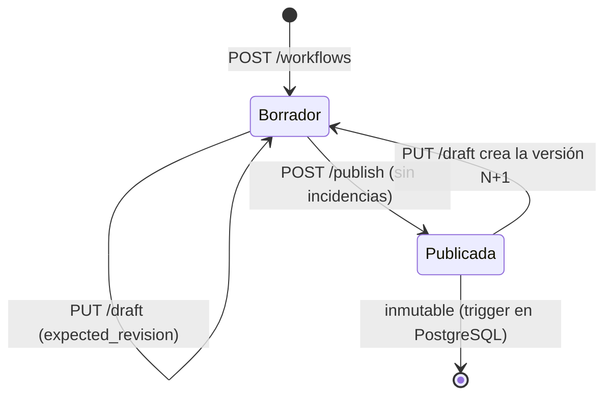

# Definición de flujos (DSL)

Un flujo es un **grafo dirigido acíclico** de pasos, descrito en JSON. Se valida en dos
niveles:

1. **Estructura** (Pydantic). Si un campo es desconocido, un tipo es incorrecto o se supera
   un límite, la API responde `422` y no guarda nada.
2. **Semántica** (`validation.py`). Revisa el grafo y las referencias. Un borrador con
   incidencias **se puede guardar**, y estas vuelven en `issues`, pero **no se puede
   publicar** hasta que no quede ninguna.

## Ejemplo

```json
{
  "schema_version": 1,
  "inputs": [{ "name": "order_id", "type": "string" }],
  "start": "fetch_order",
  "steps": [
    {
      "id": "fetch_order",
      "type": "http_request",
      "config": {
        "method": "GET",
        "url": "https://api.example.com/orders/{{ input.order_id }}"
      },
      "timeout_seconds": 10,
      "retry": { "max_attempts": 3, "initial_backoff_seconds": 2 },
      "next": "is_paid"
    },
    {
      "id": "is_paid",
      "type": "condition",
      "config": {
        "when": {
          "all": [
            { "field": "steps.fetch_order.output.status_code", "op": "eq", "value": 200 },
            { "field": "steps.fetch_order.output.body.status", "op": "eq", "value": "paid" }
          ]
        }
      },
      "on_true": "notify",
      "on_false": "wait"
    },
    { "id": "wait", "type": "delay", "config": { "seconds": 300 } },
    {
      "id": "notify",
      "type": "http_request",
      "config": {
        "method": "POST",
        "url": "https://hooks.example.com/paid",
        "body": { "order": "{{ steps.fetch_order.output.body.id }}", "run": "{{ run.id }}" }
      }
    }
  ]
}
```

## Tipos de paso

| Tipo | Configuración | Salida (`steps.<id>.output`) | Transición |
|---|---|---|---|
| `http_request` | `method`, `url`, `headers`, `query`, `body`, `success_status`, `credential` | `status_code`, `headers`, `body` | `next` |
| `transform` | `output`: objeto con plantillas | El objeto renderizado | `next` |
| `condition` | `when`: condición | `{"result": true/false}` | `on_true` / `on_false` |
| `delay` | `seconds` (1-86 400) | `{}` | `next` |

Campos comunes a todos los pasos:
- `id`: `^[a-z][a-z0-9_]{0,62}$`
- `name`: opcional
- `timeout_seconds`: 1-300, por defecto 30
- `retry`: `max_attempts` 1-10, `initial_backoff_seconds`, `backoff_multiplier`, `max_backoff_seconds`

Si una transición es `null`, la ejecución termina en ese paso.

### Efectos secundarios (`side_effect`)

Solo en `http_request`. Determina si un reintento es seguro:

| Valor | Por defecto para | Reintento tras un timeout con resultado desconocido |
|---|---|---|
| `none` | `GET` | Sí |
| `idempotent` | `PUT`, `DELETE` | Sí, con la misma `Idempotency-Key` |
| `non_idempotent` | `POST`, `PATCH` | **No**: el paso queda en revisión manual |

Si tu API trata un `POST` de forma idempotente gracias a la cabecera `Idempotency-Key`,
declara `"side_effect": "idempotent"`.

## Plantillas

`{{ ruta }}` dentro de cualquier cadena de `url`, `headers`, `query`, `body` o `output`.

| Raíz | Ejemplo | Regla |
|---|---|---|
| `input` | `{{ input.order_id }}` | La entrada debe estar declarada en `inputs` |
| `steps` | `{{ steps.fetch.output.body.items.0.id }}` | El paso debe ejecutarse **con certeza** antes (lo domina en el grafo) |
| `run` | `{{ run.id }}`, `{{ run.workflow_id }}` | Metadatos de la ejecución |

- Si la cadena es *solo* una plantilla, el valor conserva su tipo: número, objeto o lista.
- Dentro de un texto, el valor se convierte a texto.
- No hay expresiones, llamadas, filtros ni aritmética. Un valor que contenga `{{ }}` se
  inserta literalmente, nunca se vuelve a evaluar.

## Condiciones

```json
{ "field": "<ruta>", "op": "<operador>", "value": <JSON> }
{ "all": [ <condición>, ... ] }
{ "any": [ <condición>, ... ] }
{ "not": <condición> }
```

| Operadores | Comportamiento |
|---|---|
| `eq`, `ne` | Igualdad JSON |
| `gt`, `gte`, `lt`, `lte` | Solo entre números o entre cadenas. Con tipos distintos el resultado es `false`, no un error |
| `in`, `not_in` | `value` debe ser una lista |
| `contains` | Subcadena, o elemento de una lista |
| `exists`, `not_exists` | El campo existe y no es `null` |

Un campo inexistente hace falsa cualquier comparación, salvo `ne`, `not_in` y `not_exists`.

## Incidencias de validación

| Código | Significado |
|---|---|
| `duplicate_step_id` | Dos pasos con el mismo `id` |
| `unknown_start` / `unknown_step` | Una transición o referencia apunta a un paso que no existe |
| `self_loop` / `cycle` | El grafo no es acíclico |
| `unreachable_step` | El paso no se alcanza desde `start` |
| `unknown_input` | Plantilla con una entrada no declarada |
| `reference_not_guaranteed` | Plantilla con la salida de un paso que puede no haberse ejecutado (está en otra rama o va después) |
| `invalid_reference` / `malformed_template` | Ruta o plantilla mal escritas |

## Ciclo de vida de las versiones



- Como máximo existe **un borrador** por flujo; lo garantiza un índice único parcial.
- Cada guardado del borrador incrementa `revision`. Si dos personas editan a la vez, la
  segunda recibe `409` en lugar de sobrescribir el trabajo de la primera.
- Las ejecuciones (Fase 4) siempre usan una versión publicada concreta.
